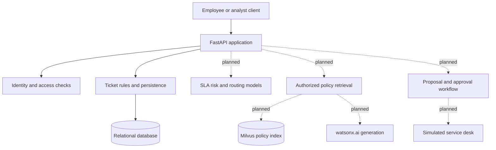

# OpsPilot

OpsPilot is a service operations assistant for a fictional organization. It is designed to help employees submit service requests and help support teams prioritize work, find relevant policies, and review proposed actions. Example services include account access, software requests, purchases, data reporting, and policy questions.

The project uses synthetic identities and data. Operational changes are intended for a simulated service desk and require human review.

## Architecture

The API is the authority for identity, ticket ownership, team scope, and service rules. Prediction and language models assist users; authorization and approval rules remain deterministic server logic.

### Implemented foundation

- **API:** FastAPI and Pydantic validate ticket intake and return authorized ticket records.
- **Domain rules:** The server assigns the owning team and snapshots the resolution SLA at creation.
- **Persistence:** SQLAlchemy models and Alembic migrations describe the relational schema. SQLite supports local development; PostgreSQL is the intended deployment target.
- **Local authentication:** Signed development tokens map to seeded fictional identities. Employees read their own tickets; analysts read tickets assigned to their team.
- **Retry handling:** Client request IDs prevent duplicate ticket creation and reject conflicting payloads.

### Planned components

- Intake-time SLA breach prediction and team-routing recommendations.
- Authorized policy retrieval with Milvus and grounded answers through watsonx.ai.
- Human approval, durable execution, and audit records for simulated actions.
- A Streamlit interface, operational dashboards, and watsonx Orchestrate tools.

These components are planned and are not part of the current implementation.

## Repository structure

| Path | Responsibility |
|---|---|
| `src/opspilot/api/` | HTTP routes, schemas, and authentication |
| `src/opspilot/domain/` | Service catalogue and deterministic rules |
| `src/opspilot/db/` | Persistence models, sessions, and synthetic seed data |
| `migrations/` | Database schema history |
| `scripts/` | Local setup helpers |
| `tests/` | API and configuration test cases |

## Local development

Use Python 3.11 or later. Install the package with `python -m pip install -e ".[dev]"` and copy `.env.example` to `.env`. Generate a private signing key with `python -c "import secrets; print(secrets.token_urlsafe(32))"` and set `OPSPILOT_DEV_TOKEN_SECRET` in `.env`; no signing key is supplied by the project.

Apply migrations with `alembic upgrade head`, seed fictional identities with `python scripts/seed_dev.py`, and start the API with `uvicorn opspilot.main:app --reload --app-dir src`.

Development token authentication is intended for local use. An internet-accessible application requires deployment authentication and private secret configuration.
